# SmartCity AI: user manual

This manual explains how to install and start SmartCity AI, then how each of the three roles uses it:

| Role | Who | Signs in from | Main job |
|---|---|---|---|
| **Citizen** | Any resident | Home page, **Citizen Portal** | Reports civic issues and tracks them |
| **Department staff** | Officers of one municipal department | Home page, **Department Portal** | Works through their department's queue of complaints |
| **Administrator** | City control room | Home page, **Department Portal** | Oversees every department, approves staff and redirects complaints |

Contents:

1. [Installing on a new computer](#1-installing-on-a-new-computer) (once)
2. [Starting and stopping the app](#2-starting-and-stopping-the-app) (every time)
3. [Citizen guide](#3-citizen-guide)
4. [Department staff guide](#4-department-staff-guide)
5. [Administrator guide](#5-administrator-guide)
6. [How the AI decides](#6-how-the-ai-decides)
7. [Demo data and demo accounts](#7-demo-data-and-demo-accounts)
8. [Troubleshooting](#8-troubleshooting)

---

## 1. Installing on a new computer

Skip this section on a laptop where the project already runs: go straight to [section 2](#2-starting-and-stopping-the-app).

**You need:** Windows 10/11 (the steps also work on Linux or macOS, with the paths changed), **Python 3.12**
(during installation, tick *"Add python.exe to PATH"*), **Git**, and a modern browser (Chrome or Edge).

Open *Command Prompt* or *PowerShell* and run:

```bat
:: 1. Get the code
git clone https://github.com/Https-Ankit-net/SmartCity-AI.git
cd SmartCity-AI

:: 2. Create a virtual environment in the project folder and install the backend (about 1 GB, mostly PyTorch)
python -m venv .venv
.venv\Scripts\python.exe -m pip install --index-url https://download.pytorch.org/whl/cpu --extra-index-url https://pypi.org/simple -r backend\requirements.txt
```

**3. The custom AI model (recommended).** The trained civic-issue detector, `civic-yolov8.pt` (6 MB), is **not on GitHub**.
Copy it from the original laptop (`backend\app\ai\weights\civic-yolov8.pt`) or a pen-drive to the same path on the new
computer. Without it the app still runs, but photos are read by the generic YOLOv8 model, which cannot recognise potholes
or garbage, so complaints are routed from their text alone. To train the model yourself, see
[model_evaluation.md](model_evaluation.md#6-reproduce).

**4. Settings (optional).** The app runs without any settings file: it uses a local SQLite database file
(`backend\smartcity_ai.db`, created automatically) and prints e-mails to the server window instead of sending them. To
change this, create `backend\.env` (the keys are listed in `.env.example`), for example a long random `JWT_SECRET`,
`JWT_EXPIRE_MINUTES=1440` (stay signed in for a day), or SMTP settings to send real e-mails.

**5. Create the first administrator.** Administrators cannot sign up from the website, for security. Create one from
the command line:

```bat
cd backend
..\.venv\Scripts\python.exe -m app.manage create-admin --email admin@yourcity.gov --name "City Admin"
cd ..
```

The command asks for a password (at least 8 characters). Run it again with a different e-mail address to add more
administrators.

**6. Demo data (optional).** To fill the app with a realistic month of complaints for a presentation, see
[section 7](#7-demo-data-and-demo-accounts).

---

## 2. Starting and stopping the app

### The easy way (Windows)

Double-click **`start_demo.bat`** in the project folder.

1. A minimised window called **"SmartCity AI backend - close this window to stop"** starts the server.
2. The script waits until the server answers (about 10 to 20 seconds the first time).
3. The home page opens in your browser.

**To stop the app, close the "SmartCity AI backend" window.** If the server is already running, the script just opens
the home page again.

### The manual way (any OS)

```bat
cd backend
..\.venv\Scripts\python.exe -m uvicorn app.main:app --port 8000
```

Leave this window open. Then open **`frontend\index.html`** in the browser by double-clicking it.
Stop the server with **Ctrl+C**.

### Checking that it works

- The home page shows a green **Backend Online** badge in the top bar.
- http://127.0.0.1:8000/docs shows the interactive API documentation.
- On the first start the server creates or upgrades the database automatically and adds the seven departments: Fire
  Services, Traffic Police, Sanitation, Water, Electrical, Public Works and the Municipal Control Room.

> **Internet:** the map tiles, icons and fonts load from the internet, so keep the computer online. The app itself,
> its database and the AI model all run on this computer.

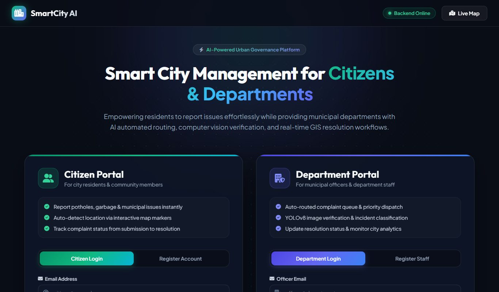

The home page has two login cards. Use the **Citizen Portal** if you are a resident, and the **Department Portal** if
you are department staff or an administrator. Staff and administrators share one login form, and the app recognises
which one you are.

---

## 3. Citizen guide

### 3.1 Create an account and sign in

1. On the home page, in the **Citizen Portal** card, click **Register Account**.
2. Enter your full name, e-mail, phone number (optional) and a password of at least 8 characters, then click
   **Create Citizen Account**.
3. Sign in on the **Citizen Login** tab with the same e-mail and password.

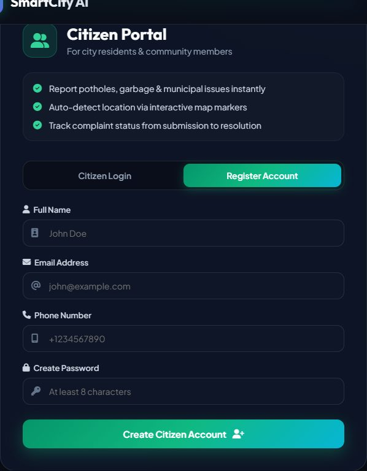

### 3.2 Your dashboard

After signing in you land on **My Complaints**:

- **Counters:** total reports, Pending, In Progress and Resolved, plus your personal resolution rate.
- **Complaint cards:** each card shows the photo (or an icon), the category the AI chose, the status, the location
  (ward and zone) and the department handling it. **AI: text** means the category came from your description;
  **AI 83%** means the photo was recognised with 83 % confidence. A **"You confirmed this report"** card is someone
  else's report of the same problem that your report was merged into (see [3.4](#34-duplicate-reports)).
- **Filters and search:** the *All / Pending / In Progress / Resolved* tabs and the search box (title, location or
  category).
- **Bell icon:** live notifications whenever a department updates one of your complaints. Use **Mark all as read**
  and **Clear** to tidy the list.
- **Profile & Settings:** your name and phone number, plus notification preferences. In-app alerts work out of the box.
  E-mail updates are sent only when the server has SMTP configured (otherwise they are printed in the server window).
  SMS is a saved preference only; sending SMS is not built yet.

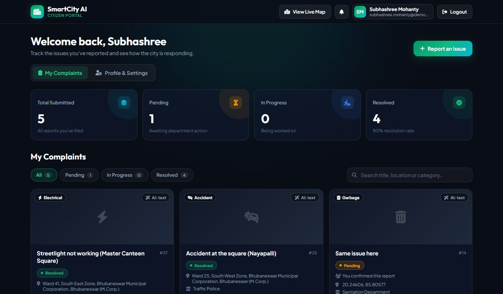

### 3.3 Report an issue

1. Click **Report an Issue** (top right of the dashboard). This opens the **live map**.
2. Click the **target button** (bottom left) and allow location access in the browser. The map flies to where you are.
   **Your report is placed at this location.** If you don't use it, the report is placed at the centre of
   Bhubaneswar.
3. Click the green **+** button (bottom left) to open **Report Incident**.
4. Fill in the form:
   - **Incident Title:** a short summary, for example "Deep pothole outside my lane".
   - **Description:** what is wrong. You can click **Voice Input** to dictate it (Chrome/Edge). Words such as
     *dangerous*, *children*, *injured* or *urgent* raise the severity and priority.
   - **Category:** an optional hint. The AI decides the category from your description and photo.
   - **Incident Photo Attachment:** add a photo (JPG, PNG or WEBP, up to 10 MB). This is optional, but a photo lets
     the AI recognise potholes, overflowing garbage and fallen trees even if your description is vague.
5. Click **Submit Report**. Within a few seconds you get **"Report #… submitted successfully!"** and a new marker appears
   on the map. The first photo after the server starts takes about 10 seconds while the AI model loads; later ones are
   quicker.

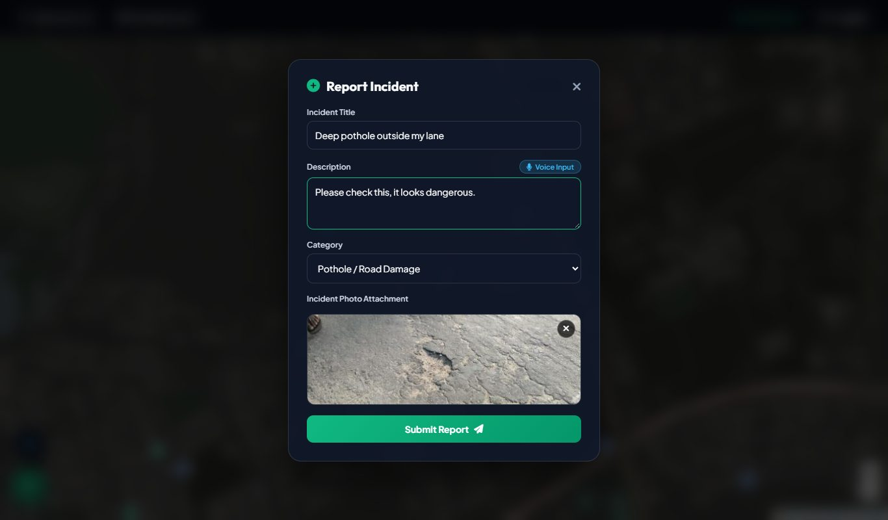

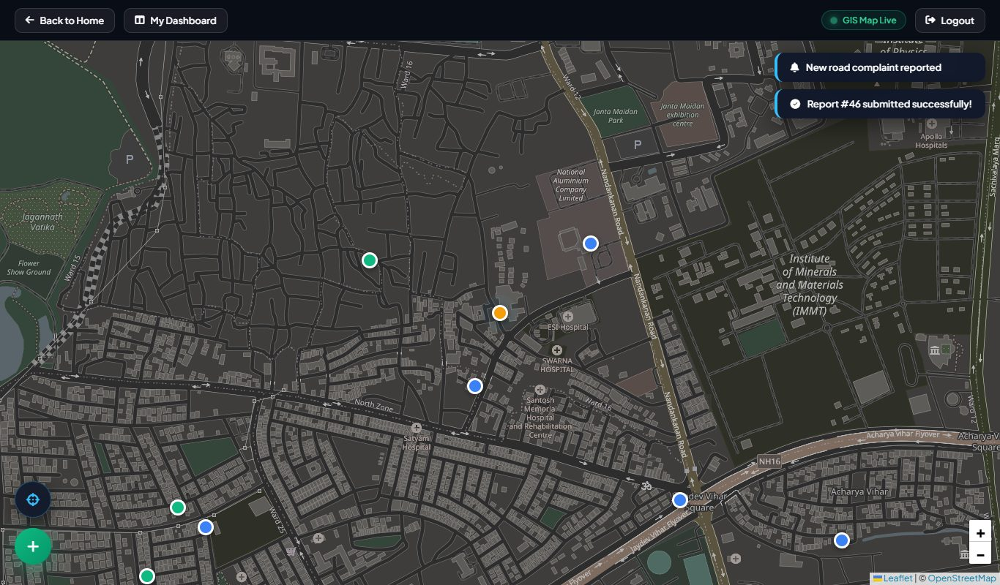

**Map markers:** orange is pending, blue is in progress, green is resolved and red is fire. Click a marker for its
details. **My Dashboard** (top left) takes you back.

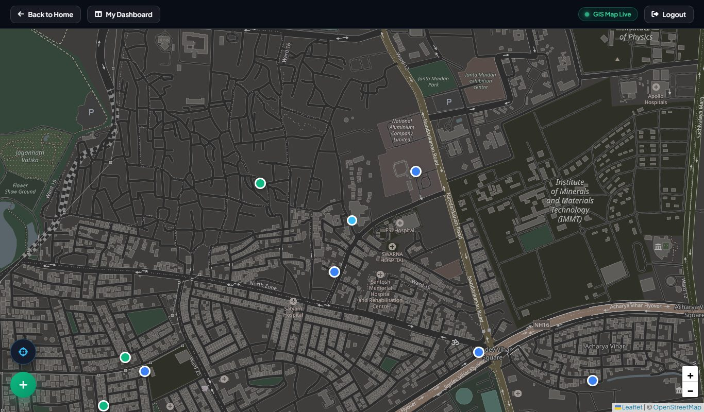

### 3.4 Duplicate reports

If someone already reported **the same kind of issue within 50 m in the last 24 hours** and it is still open, your
report is **not** created again. Instead it is added as a **confirmation** of the existing complaint, and you see
*"A matching report (#…) already exists … away. Your report was added as a confirmation."* The department sees how many citizens confirmed it (**+2**, **+4** …). Three or more confirmations
raise the complaint's severity. Reporting the same thing twice yourself is ignored.

### 3.5 Follow a complaint

Click **View details** on a card. You see:

- the photo and description;
- the **AI Detection** box: detected category, priority, photo confidence and the **severity score (1–10)** with the
  reasons for it;
- the location, with links to open it on the map;
- the **Progress Timeline:** Submitted → Assigned to Dept → In Progress → Resolved, with dates;
- the **Department Response:** the official messages the department wrote to you.

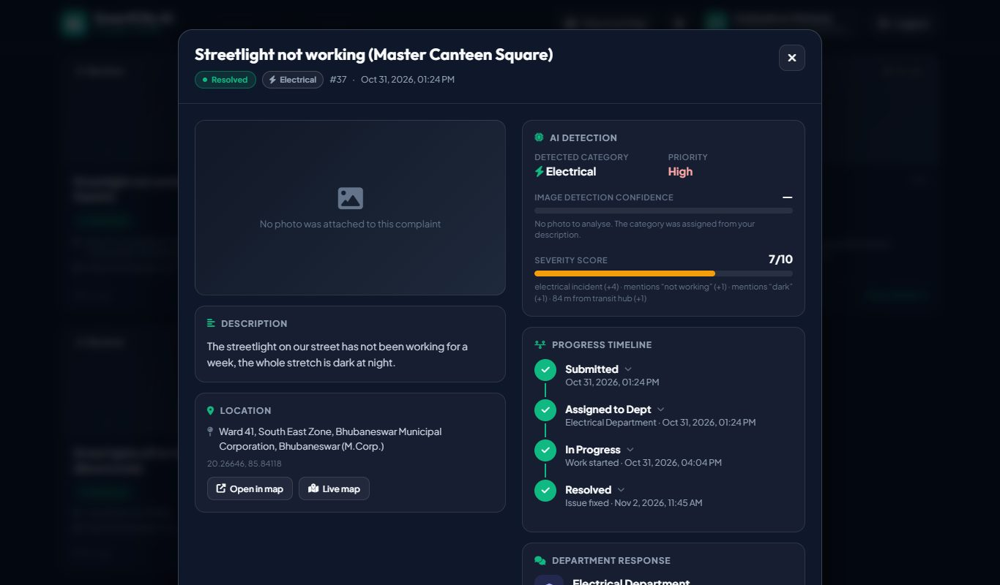

---

## 4. Department staff guide

### 4.1 Request an account

1. On the home page, in the **Department Portal** card, click **Register Staff**.
2. Enter your name, official e-mail, **department** and a password, then click **Register Department Account**.
3. Your account is now **pending**. Until an administrator approves it, signing in shows *"Your department account is
   awaiting approval by a city administrator."* Administrators get a live notification of your request.

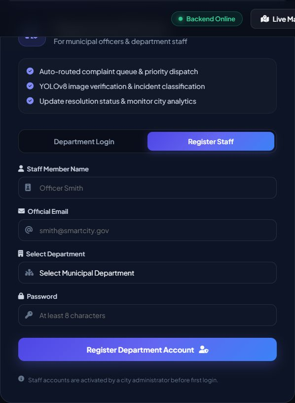

### 4.2 Your department dashboard

Once approved, sign in on the **Department Login** tab. The dashboard is titled with your department, for example
*Public Works Department Dashboard*, and shows **only your department's complaints**:

- **Cards:**
  - **Department Complaints:** total and open complaints.
  - **Resolution Rate:** how many of them are resolved.
  - **Avg Response Time:** from filing to the first staff action, with the average time to resolve underneath.
  - **Escalated:** open complaints that waited too long. That means **High priority for over 24 hours, or any
    priority for over 72 hours**. Click the card to show only those complaints.
- **Charts:** complaints by category, and reported-vs-resolved per day (**7D / 30D / 90D**). **Table** shows the
  numbers behind each chart.
- **Complaint Management:** your queue, with search, status, urgency and date filters and an **Escalated** toggle.
  Click a column header to sort. Escalated rows have a red edge. The **Severity x/10** badge lists its reasons when you
  hover over it, and **+N** is the number of citizen confirmations.
- **Live** (top bar): new complaints appear instantly, with a pop-up.

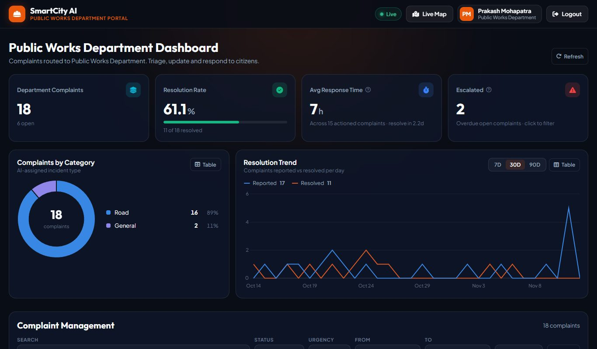

### 4.3 Work on a complaint

Click **Change Status** (or **View**) on a row. The window shows the evidence photo, the description, a map and the
**Activity** history. Then:

1. On the **Update Status** tab, choose the **New status**: *Pending → In Progress → Resolved*, or *Rejected* if it is
   not a valid complaint.
2. Write an **Official response to citizen** (*visible to citizen*), for example "A team will repair this by Friday."
3. Optionally add an **Internal note** (*staff only*). Citizens never see it.
4. Click the button (for example **Mark as In Progress**). The citizen is notified immediately.

You can also just add a response or note without changing the status.

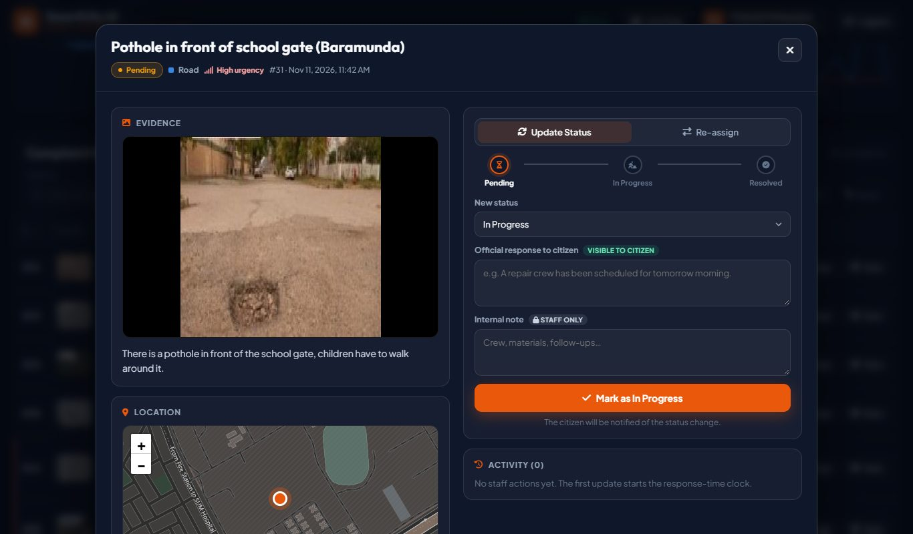

**Wrong department?** On the **Re-assign** tab, choose **Move to department**, add a note, and click **Re-assign**. The
complaint then leaves your queue and appears in the other department's queue.

---

## 5. Administrator guide

Administrators sign in on the **Department Login** tab with the account created in
[step 5 of the installation](#1-installing-on-a-new-computer). The **City Operations Dashboard** is the staff
dashboard for the **whole city**, with three extras.

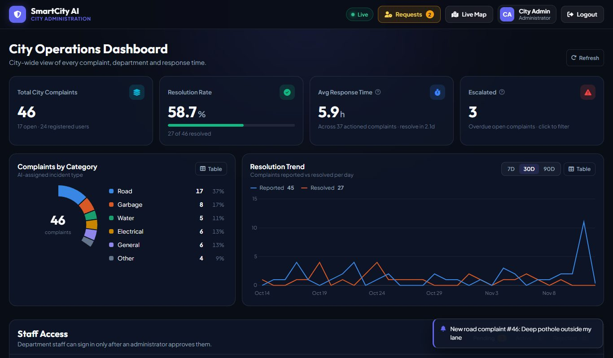

### 5.1 City-wide overview

- **Total City Complaints:** includes the number of registered users. The other cards (resolution rate, response time,
  escalated) and the charts cover every department.
- **Complaint Management** has a **Department** filter, so you can look at one department's queue.
- You can update and re-assign **any** complaint, exactly as described in [4.3](#43-work-on-a-complaint).

### 5.2 Approve department staff

The **Requests** button in the top bar shows how many staff sign-ups are waiting, and clicking it jumps to the **Staff
Access** panel.

- **Pending:** for each request, check the department in the drop-down (you can correct it), then click **Approve** or
  **Reject**.
- **Active:** current staff. Click **Revoke** to block an account immediately.
- **Rejected:** declined or revoked accounts. Click **Reinstate** to give one access again.

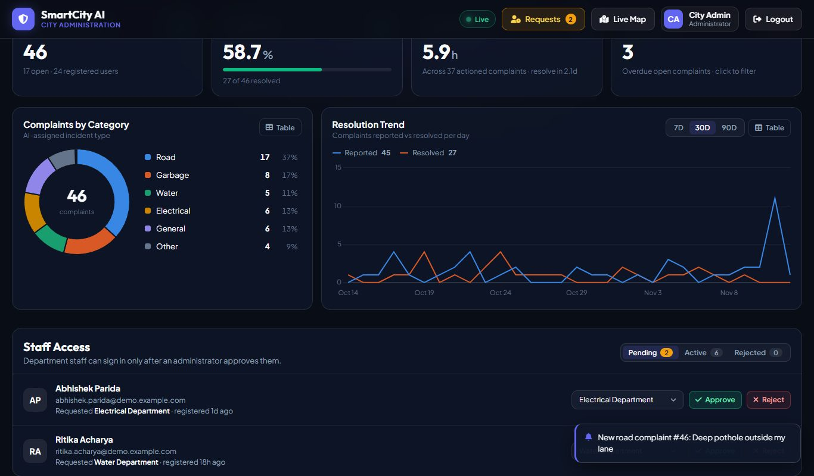

### 5.3 Route complaints the AI could not place

Complaints the AI could not match to a department go to the **Municipal Control Room**. Filter **Department → Municipal
Control Room**, open each one with **Re-assign**, choose the right department, add a note, and click **Re-assign**.

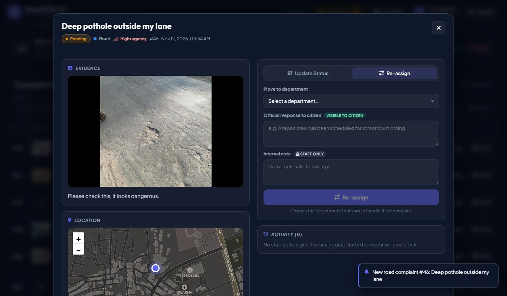

### 5.4 Command-line tasks

Run these from the `backend` folder with the virtual environment's Python:

| Task | Command |
|---|---|
| Add an administrator | `..\.venv\Scripts\python.exe -m app.manage create-admin --email ... --name "..."` |
| Score old complaints that have no severity | `..\.venv\Scripts\python.exe -m app.manage backfill-severity` |

---

## 6. How the AI decides

When a complaint is submitted, the server:

1. **Reads the description.** Keywords decide the category and department:
   - fire or smoke goes to Fire Services;
   - accident goes to Traffic Police;
   - garbage goes to Sanitation;
   - leak, drain or sewage goes to Water;
   - wire, power or streetlight goes to Electrical;
   - pothole or fallen tree goes to Public Works.
2. **Looks at the photo** (if there is one) with the custom YOLOv8 model, which was trained to find **potholes,
   overflowing garbage and fallen trees**. If the description has no keyword, the photo decides. If neither matches, the
   complaint goes to the **Municipal Control Room**.
3. **Scores severity from 1 to 10**, adding up explainable factors:
   - how dangerous the category is;
   - alarming words in the description;
   - a confident photo detection;
   - closeness to hospitals, schools, emergency services, transit hubs or a main road, taken from OpenStreetMap data
     for Bhubaneswar.

   The factors are stored with the complaint, so staff can see *why* it is scored that way.
4. **Sets the priority** (Low / Medium / High) from the category and severity. Words like *urgent* or *immediately*
   raise it one level.
5. **Checks for duplicates** within 50 m and 24 hours (see [3.4](#34-duplicate-reports)).

The model's accuracy and its limits are documented in [model_evaluation.md](model_evaluation.md). In particular,
**streetlight failures are not recognised from photos yet**, so write "streetlight" in the description.

---

## 7. Demo data and demo accounts

`scripts/seed_demo_data.py` fills the database with realistic data for a presentation:

- 12 citizens;
- 6 approved staff (one per department) and 2 pending staff requests;
- 45 complaints across Bhubaneswar over the past month, mostly resolved and some in progress, pending, rejected or
  escalated, with full status history, replies to citizens and confirmations.

Photos come from the test images of the model's dataset. On a computer without the `datasets` folder, the complaints
are created without photos.

**Stop the server first**, then run from the project folder:

```bat
.venv\Scripts\python.exe scripts\seed_demo_data.py --replace-test-complaints
```

- **Backup:** the database is backed up to `backend\backups\` before anything changes. To go back, stop the server and
  copy a backup over `backend\smartcity_ai.db`.
- **Re-run before a presentation:** the dates are relative to the moment you run it, so "today's" pending complaints
  stay fresh. Running it again replaces the previous demo data.
- **Remove:** `--remove` deletes the demo data.
- **`--replace-test-complaints`** also removes the old identical "Live Complaint" test entries.
- **Your own accounts are never touched.**

**Demo accounts** (all with the password `Demo@2026`):

| Role | E-mail | Notes |
|---|---|---|
| Citizen | `subhashree.mohanty@demo.example.com` | Also rakesh.panda, priyanka.nayak, bikash.sahoo … (12 citizens) |
| Staff, Public Works | `prakash.mohapatra@demo.example.com` | |
| Staff, Sanitation | `smita.tripathy@demo.example.com` | |
| Staff, Electrical | `ajay.kumar.dash@demo.example.com` | |
| Staff, Water | `rashmi.samal@demo.example.com` | |
| Staff, Traffic Police | `sanjay.barik@demo.example.com` | |
| Staff, Fire Services | `pradeep.senapati@demo.example.com` | |
| Pending staff | `ritika.acharya@`, `abhishek.parida@demo.example.com` | Cannot sign in until an admin approves them |
| Administrator | your own account | Created with `create-admin`; the seed creates no admin |

**A suggested demo of about 10 minutes:**

1. **Admin:** sign in to show the city-wide dashboard, charts and the escalated complaints.
2. **Citizen:** register a new account live, open the map, use your location, and report a pothole with a photo and a
   vague description such as "please check this, it looks dangerous".
3. **Admin:** the new complaint pops up live. Open it: the AI sent it to **Public Works**, with a severity score and
   reasons.
4. **Admin:** approve one of the pending staff requests, and forward the Control Room complaint to a department.
5. **Staff:** sign in as `prakash.mohapatra@demo.example.com`. The queue shows only Public Works. Mark the new pothole
   *In Progress* with a message to the citizen.
6. **Citizen:** the bell shows the update, and **View details** shows the timeline and the department's response.

Use a different browser profile or an *InPrivate/Incognito* window for each role, because the same browser window
stays signed in as one person.

---

## 8. Troubleshooting

| Problem | Fix |
|---|---|
| The home page says the backend is offline, or login does nothing | The server isn't running. Start `start_demo.bat` and wait for "Backend is up". |
| `start_demo.bat` says port 8000 is in use | Another copy is already running, so just use it. Otherwise close the program using port 8000. |
| `start_demo.bat` says ".venv was not found" | Do [section 1](#1-installing-on-a-new-computer) step 2. |
| Staff login says "awaiting approval" | An administrator must approve the account ([5.2](#52-approve-department-staff)). |
| The admin dashboard shows "–" for a few seconds | Normal: it is loading. Wait a moment or press **Refresh**. |
| "A matching report (#…) already exists … Your report was added as a confirmation." | It was within 50 m of the same kind of open issue ([3.4](#34-duplicate-reports)). Use your real location, or report a different issue. |
| The first photo report is slow | The AI model loads on first use (about 10 seconds); later reports are quicker. |
| Every report lands in the same spot | Click the location button on the map and allow location access first. |
| The map is grey, or icons are missing | No internet connection: map tiles and icons come from the web. |
| "Session expired. Please login again." | Sign in again. Sessions last `JWT_EXPIRE_MINUTES` (default 60 minutes). |
| Photos are not recognised (everything says "AI: text") | `backend\app\ai\weights\civic-yolov8.pt` is missing; see [section 1](#1-installing-on-a-new-computer) step 3. |
| Forgot the administrator password | Create another administrator with `create-admin` ([5.4](#54-command-line-tasks)). |
